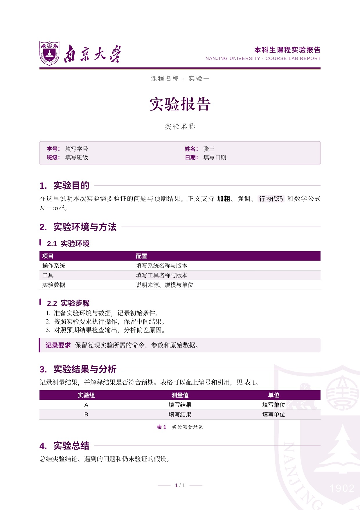

# NJU 实验报告模板

南京大学风格的非官方课程实验报告模板，包名为 `nju-exp-report`。


## 安装与新建报告

```bash
git clone git@github.com:yama-lei/nju-exp-report-typst-template.git
cd nju-exp-report-typst-template
bash scripts/package @local

typst init @local/nju-exp-report:0.1.0 my-report
typst compile my-report/main.typ my-report/main.pdf
```


可以通过ming ling h
```bash
typst compile \
  --input student-name=张三 \
  --input student-id=填写学号 \
  --input report-date=填写日期 \
  my-report/main.typ my-report/main.pdf
```

这些 `--input` 是示例 `main.typ` 读取的字段，不是包的隐式配置。报告内容和其他字段直接在源文件中修改。

### 手动安装与卸载

把 `typst.toml`、`src/`、`template/`、`LICENSE`、`THIRD_PARTY.md` 和 `licenses/` 复制到以下目录的 `nju-exp-report/0.1.0/` 中：

| 系统 | 本地包根目录 |
| --- | --- |
| Linux | `${XDG_DATA_HOME:-~/.local/share}/typst/packages/local/` |
| macOS | `~/Library/Application Support/typst/packages/local/` |
| Windows | `%APPDATA%\typst\packages\local\` |


## 在现有文档中使用

```typ
#import "@local/nju-exp-report:0.1.0": *

#show: nju-lab.with(
  title: "实验报告",
  subtitle: "实验名称",
  course: "课程名称 · 实验一",
  author: "张三",
  info: (
    "学号": "填写学号",
    "姓名": "张三",
    "日期": "填写日期",
  ),
)

= 实验目的

在这里开始正文。
```

`info` 使用字典，按填写顺序排列，每行容纳两组“标签、值”。值可以是字符串或 Typst 内容，奇数个字段也可以排版。

### 模板参数

| 参数 | 默认值 | 用途 |
| --- | --- | --- |
| `title` | `"实验报告"` | 首页标题、后续页右侧页眉、PDF 标题 |
| `subtitle` | `none` | 首页副标题 |
| `course` | `none` | 首页课程名称、后续页左侧页眉 |
| `author` | `none` | PDF 作者元数据，姓名卡片需另写入 `info` |
| `kind` | `"本科生课程实验报告"` | 首页右上方的报告类型 |
| `header-left` | `none` | 自定义后续页左侧页眉，默认使用 `course` |
| `info` | `(:)` | 首页信息卡，留空则隐藏 |
| `first-line-indent` | `0pt` | 正文首行缩进，可设为 `2em` |

正文通过 `#show: nju-lab.with(...)` 传入。`import` 本身不会修改文档样式。页面固定为 A4，字体、字号和边距沿用原实验报告的默认设置。

### 表格、提示与附录标题

```typ
#nju-table(
  columns: (1fr, 2fr),
  table.header(hcell[项目], hcell[说明]),
  [环境], [填写实验环境],
  [工具], [填写版本号],
)

#nju-note(title: "注意")[在这里填写需要强调的内容。]

#nju-section[附录]
```

- `nju-table(..args)` 接受 Typst `table` 参数，默认紫色首行、浅色隔行和横线。首行文字用 `hcell(body)` 设为白色粗体，`table.header` 可让跨页表头重复。
- `nju-note(title: "说明", body)` 绘制提示框。
- `nju-section(body)` 绘制不编号的装饰标题，不进入目录，也不改变正文标题计数。
- `nju-title-block(...)` 仅生成首页标题区，接受 `title`、`subtitle`、`course`、`kind` 和 `info`，不设置页面和正文样式。

还导出 `nju-purple`、`nju-purple-dark`、`nju-purple-light`、`nju-purple-mid`、`nju-gold` 和字体字典 `nju-fonts`，可供正文中的自定义组件使用。

## 不安装包，下载源码

将仓库放在文档可访问的项目根目录内，改为相对路径导入：

```typ
#import "nju-exp-report-typst-template/src/lib.typ": *
```


## 开发与验证

```bash
python3 -m unittest discover -s tests -v
just doc
just package out
```

## 许可与来源

模板代码采用 [MIT 许可证](LICENSE)。校徽和校名来自 OrangeX4 的 [modern-nju-thesis](https://github.com/nju-lug/modern-nju-thesis)，已保留其 MIT 版权声明。辅助打包脚本包含 Apache-2.0 代码，详见 [THIRD_PARTY.md](THIRD_PARTY.md)。本模板并非南京大学官方格式，提交前请核对课程要求。
